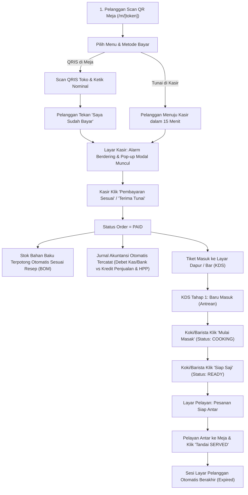
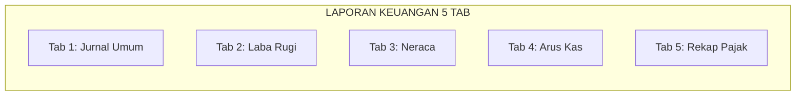

# BUKU PANDUAN OPERASIONAL & SOP SISTEM f&b1621
**POS, Inventory, & Akuntansi F&B Web (PWA)**  
*Dokumen Resmi Operasional untuk Seluruh Role Pengguna*

---

## DAFTAR ISI
1. [Ringkasan Sistem & Arsitektur f&b1621](#1-ringkasan-sistem--arsitektur-fb1621)
2. [Peta Alur Kerja Utama (End-to-End Workflow)](#2-peta-alur-kerja-utama-end-to-end-workflow)
3. [Panduan Role Pelanggan (Self-Order di Meja)](#3-panduan-role-pelanggan-self-order-di-meja)
4. [Panduan Role Kasir (Workspace Kasir, Order Manual, & Tutupan Shift)](#4-panduan-role-kasir-workspace-kasir-order-manual--tutupan-shift)
5. [Panduan Role Dapur / Bar (Kitchen Display System 3-Tahap)](#5-panduan-role-dapur--bar-kitchen-display-system-3-tahap)
6. [Panduan Role Pelayan / Waiter (Layar Antar Pesanan)](#6-panduan-role-pelayan--waiter-layar-antar-pesanan)
7. [Panduan Role Staf Gudang / Barista (Inventory, Resep, Opname, & Waste)](#7-panduan-role-staf-gudang--barista-inventory-resep-opname--waste)
8. [Panduan Role Owner (Pengaturan Outlet, QRIS, Audit Trail, & Akuntansi 5 Tab)](#8-panduan-role-owner-pengaturan-outlet-qris-audit-trail--akuntansi-5-tab)
9. [Standar Operasional Prosedur (SOP) Harian Outlet](#9-standar-operasional-prosedur-sop-harian-outlet)
10. [Tanya Jawab & Troubleshooting (FAQ)](#10-tanya-jawab--troubleshooting-faq)

---

## 1. RINGKASAN SISTEM & ARSITEKTUR f&b1621

**f&b1621** adalah platform POS, Inventory, dan Akuntansi modern berbasis web (Progressive Web App / PWA) yang dirancang khusus untuk operasional restoran dan kafe berkapasitas hingga **100 meja** dan **5 perangkat kasir real-time**.

### Prinsip Utama Sistem:
1. **Aman & Akurat Tanpa Float:** Seluruh transaksi uang disimpan sebagai integer Rupiah (`Rp 25.000`), mencegah kesalahan pembulatan desimal.
2. **Kalkulasi Terpusat di Server:** Nilai subtotal, diskon, service charge, pajak, dan total dihitung di server, tidak mempercayai input klien/browser.
3. **Pemisahan Peran yang Tegas (RBAC):**
   - **Pelanggan:** Memesan di meja via scan QR tanpa perlu download aplikasi atau login.
   - **Kasir:** Menerima pembayaran (QRIS/Tunai), revisi order pending, diskon, dan cetak struk tutupan shift.
   - **Dapur / Bar:** Menyiapkan pesanan lunas lewat KDS 3-Tahap (Baru $\rightarrow$ Mulai Masak $\rightarrow$ Siap Saji).
   - **Pelayan:** Mengantarkan pesanan siap saji dan menandai pesanan selesai disajikan (`SERVED`).
   - **Gudang:** Mengelola bahan baku, resep/BOM, transfer antar-lokasi, stock opname blind count, dan pencatatan waste.
   - **Owner:** Kontrol penuh atas pengaturan outlet, upload QRIS, approval opname, audit trail, dan laporan akuntansi 5 tab.
4. **Audit Trail Mutlak (Append-Only):** Setiap aksi perubahan data dicatat otomatis dengan hash tamper-proof, user ID, role, IP, waktu server WIB, dan nilai sebelum/sesudah.

---

## 2. PETA ALUR KERJA UTAMA (END-TO-END WORKFLOW)



---

## 3. PANDUAN ROLE PELANGGAN (SELF-ORDER DI MEJA)

### Karakteristik & Akses:
- **Alamat Akses:** Scan kode QR fisik di meja $\rightarrow$ mengarah ke URL `/m/[token]`.
- **Tanpa Login:** Pelanggan tidak perlu mendaftar atau mengingat kata sandi.
- **Validasi Server:** Nomor meja dikunci dari `qr_token` database, pelanggan tidak dapat mengubah nomor meja sendiri.

### Langkah-langkah Pemesanan:
1. **Pindai QR Meja:** Buka kamera ponsel atau aplikasi scanner, pindai QR code yang tertempel di meja.
2. **Pilih Menu:**
   - Telusuri menu berdasarkan kategori (Makanan, Kopi, Non-Kopi, Camilan, dll.).
   - Klik menu untuk menambahkan ke keranjang.
   - Isi catatan khusus per item jika diperlukan (contoh: *"less sugar, es sedikit"* atau *"jangan pakai daun bawang"*).
3. **Pilih Metode Pembayaran:**
   - **Opsi A: QRIS di Meja (Disarankan)**
     - Layar menampilkan gambar QRIS toko utuh asli beserta nama merchant resmi.
     - Di bawah QRIS tertera banner tebal:  
       `Ketik / Pastikan Nominal Tagihan: Rp XX.XXX`
     - Buka m-Banking / e-Wallet (BCA Mobile, Livin Mandiri, GoPay, OVO, ShopeePay, Dana, dll.), scan QRIS tersebut, dan ketik nominal sesuai tagihan.
     - Setelah transfer berhasil di m-Banking, tekan tombol **"Saya Sudah Bayar"** di layar ponsel (tanpa perlu repot upload bukti transfer).
   - **Opsi B: Tunai di Kasir**
     - Layar menampilkan batas waktu pembayaran **15 Menit**.
     - Pelanggan menuju meja kasir dan menyebutkan nomor meja untuk membayar tunai.
4. **Pantau Status Pesanan Real-Time:**
   - Layar ponsel akan otomatis memperbarui status tanpa perlu refresh:
     - `Menunggu Verifikasi Kasir` $\rightarrow$ Kasir sedang mencocokkan pembayaran.
     - `Pesanan Sedang Disiapkan / Dimasak` $\rightarrow$ Dapur sedang memproses pesanan.
     - `Pesanan Siap Diantar` $\rightarrow$ Makanan/minuman sudah selesai dibuat dan dibawa pelayan.
   - Begitu pesanan sampai di meja dan pelayan menekan `SERVED`, sesi layar meja otomatis terkunci (*expired*) untuk keamanan dan privasi.

---

## 4. PANDUAN ROLE KASIR (WORKSPACE KASIR, ORDER MANUAL, & TUTUPAN SHIFT)

Kasir memiliki 3 fungsi utama: **Workspace Kasir (`/kasir`)**, **Order Manual (`/order-manual`)**, dan **Tutupan Shift (`/kasir?tab=shift`)**.

### A. Workspace Kasir (`/kasir`)
Layar sentuh-friendly untuk memantau dan memverifikasi seluruh pesanan yang masuk dari meja pelanggan.

#### 1. Notifikasi Real-Time & Alarm Berulang (Continuous Looping Alarm)
- Ketika pelanggan mengirim pesanan baru atau menekan tombol **"Saya Sudah Bayar"** (QRIS), kasir akan menerima:
  - **Alarm Suara Chime Berulang:** Berbunyi setiap 1,8 detik terus-menerus hingga kasir mengambil tindakan.
  - **Pop-up Modal Otomatis:** Modal berkedip di tengah layar yang menampilkan Nomor Meja, Nomor Order, Metode Bayar, Total Tagihan, dan Rincian Item.
- **Tombol Aksi pada Pop-up:**
  - `Matikan Alarm`: Menghentikan dering alarm tanpa menutup jendela informasi.
  - `Terima Pesanan & Buka Order`: Langsung menghentikan alarm, membuka detail order, dan mengarahkan ke tab pending kasir.

#### 2. Pencegahan Dobel Bayar (Multi-Cashier Realtime Presence)
- Jika outlet memiliki 2 hingga 5 tablet kasir, sistem menggunakan teknologi *Presence*.
- Jika Kasir A sedang membuka Order #105, di layar Kasir B akan muncul badge:  
  `Sedang dibuka oleh Kasir A`. Hal ini mencegah dua kasir menerima pembayaran bersamaan untuk pesanan yang sama.

#### 3. Verifikasi Pembayaran:
- **Verifikasi QRIS:**
  1. Kasir memeriksa mutasi masuk pada aplikasi merchant (BCA Merchant, GoBiz, dsb.) dengan mencocokkan **Nomor Meja + Nominal Tagihan**.
  2. Klik tombol hijau: **"Pembayaran Sesuai — Terima QRIS"**.
  3. Order seketika menjadi `PAID`, tiket otomatis terkirim ke dapur, dan stok bahan baku terpotong.
- **Penerimaan Tunai:**
  1. Masukkan nominal uang yang diterima dari pelanggan (tersedia tombol cepat: Uang Pas, 50.000, 100.000, dll.).
  2. Sistem menghitung kembalian secara otomatis.
  3. Klik **"Terima Pembayaran Tunai & Cetak Struk"**.

#### 4. Fitur Revisi & Penyesuaian Pesanan (Khusus Status PENDING):
- **Revisi Item:** Kasir dapat menambah/mengurangi qty item atau mengubah catatan meja jika pelanggan ingin mengganti pesanan sebelum membayar.
- **Diskon Kasir:** Dapat memberikan diskon nominal (Rp) atau persentase (%) dengan batas toleransi yang ditentukan Owner, serta wajib mengisi alasan diskon.
- **Batalkan Order:** Pembatalan wajib menyertakan kategori alasan (Kesalahan Outlet / Pelanggan).
- **Rebilling (Menu Habis):** Jika bahan baku ternyata habis di outlet saat pelanggan sudah memesan, kasir dapat membatalkan pesanan tersebut dan membuat tiket baru secara instan.

---

### B. Order Manual Kasir (`/order-manual`)
Digunakan jika pelanggan memesan langsung di meja kasir (*walk-in customer*):
1. Pilih tipe pesanan: **Dine In (Makan di Tempat)** dengan memilih nomor meja (1-100), atau **Takeaway (Bungkus)**.
2. Ketuk item menu pada katalog untuk memasukkan ke keranjang belanja.
3. Pilih metode bayar:
   - Jika memilih **QRIS**, pop-up QRIS toko langsung terbuka di layar kasir agar pelanggan dapat langsung memindai dari meja kasir.
   - Jika memilih **Tunai**, masukkan nominal uang yang diterima.
4. Klik **"Buat Order & Selesaikan Pembayaran"**.

---

### C. Tutupan Shift & Struk (`/kasir?tab=shift`)
Dijalankan setiap kali pergantian shift kerja kasir (Shift Pagi $\rightarrow$ Sore $\rightarrow$ Malam):

1. **Identitas Shift:**
   - Isi nama kasir yang menyerahkan (**Shift In**) dan kasir penerima (**Shift Out**).
   - Tentukan rentang jam kerja shift (tersedia tombol cepat: Hari Ini, Shift Pagi, Shift Sore, Shift Malam).
2. **Input Pengeluaran Kas Shift (Petty Cash Operasional):**
   - Catat seluruh pembelian barang mendadak yang menggunakan uang laci kasir (misal: *Es Batu 3 pack Rp 15.000*, *Sayur Pasar 2 kg Rp 25.000*, *Air Galon 1 pcs Rp 6.000*).
   - Klik **(+)** untuk memasukkan ke daftar.
   - Pengeluaran ini otomatis memotong saldo target kas di laci kasir.
3. **Rekonsiliasi Kas (Uang Fisik vs Sistem):**
   - Masukkan **Modal Kas Awal** di laci (contoh: Rp 200.000).
   - Sistem secara otomatis menghitung **Target Kas Akhir di Laci**:
     $$\text{Target Kas} = \text{Kas Awal} + \text{Pendapatan Tunai} - \text{Refund Tunai} - \text{Pengeluaran Kas Shift}$$
   - Hitung fisik uang tunai di laci, lalu masukkan ke kolom **Kas Akhir Aktual**.
   - Sistem langsung menampilkan **Selisih Kas**:
     - `Pas (Rp 0)`: Uang fisik cocok sempurna dengan sistem.
     - `Kurang / Minus (-Rp XX.XXX)`: Kasir tekor/kurang setor.
     - `Lebih (+Rp XX.XXX)`: Terdapat kelebihan fisik kas.
4. **Catatan Penutup & Cetak Struk:**
   - Tulis catatan kondisi serah terima laci dan alat kasir.
   - Klik **"Simpan & Cetak Struk Tutupan Shift"**.
   - Struk thermal tercetak lengkap memuat nama kasir in/out, total omzet tunai & QRIS, rincian barang yang dibeli di shift tersebut, transaksi batal, dan kolom tanda tangan kedua kasir.

---

## 5. PANDUAN ROLE DAPUR / BAR (KITCHEN DISPLAY SYSTEM 3-TAHAP)

### Karakteristik & Akses:
- **Alamat Akses:** `/dapur` (atau via tab *Kitchen* di layar kasir).
- **Aturan Ketat:** Hanya pesanan yang sudah berstatus **`PAID`** yang dapat masuk ke dapur. Pesanan belum bayar (*Pending*) tidak akan pernah mengacaukan antrean dapur.

### Alur KDS 3-Tahap:
```text
[ TAHAP 1: BARU MASUK ]  --->  [ TAHAP 2: MULAI MASAK ]  --->  [ TAHAP 3: SIAP SAJI ]
   Tiket antrean baru              Koki klik 'Mulai Masak'        Koki klik 'Siap Saji'
   Timer tunggu berjalan           Status: COOKING                Status: READY
```

1. **Tahap 1: Tiket Baru Masuk (Queued)**
   - Menampilkan nomor meja, nomor order, jam masuk, serta daftar menu beserta varian/catatan khusus (contoh: `Pedas Level 1`, `No Sugar`, `Ekstra Es Batu`).
   - Warna kartu menunjukkan waktu tunggu:
     - Hijau: Baru masuk (< 5 menit).
     - Kuning: Mulai lama (5 - 15 menit).
     - Merah: Menunggu terlalu lama (> 15 menit, prioritas segera dibuat).
2. **Tahap 2: Mulai Masak (Cooking / In-Progress)**
   - Saat koki atau barista mulai meracik pesanan, tekan tombol **"Mulai Masak"**.
   - Waktu mulai masak (`cooking_started_at`) tersimpan di sistem.
   - Status di layar pelanggan berubah menjadi *"Pesanan Sedang Disiapkan / Dimasak"*.
3. **Tahap 3: Siap Saji (Ready to Serve)**
   - Begitu makanan/minuman selesai ditata di piring/cup, tekan tombol **"Siap Saji"**.
   - Tiket berpindah ke daftar siap antar dan otomatis memicu notifikasi di Layar Pelayan.

---

## 6. PANDUAN ROLE PELAYAN / WAITER (LAYAR ANTAR PESANAN)

### Karakteristik & Akses:
- **Alamat Akses:** `/antar` (atau via tab *Antar* di layar kasir).
- Layar ini dipegang oleh tim *food runner* atau pelayan lantai.

### Langkah-langkah Pengantaran:
1. **Periksa Daftar Siap Saji:**
   - Layar menampilkan daftar kartu pesanan yang sudah berstatus **`READY`** dari dapur/bar.
   - Terdapat penanda nomor meja tujuan yang sangat besar dan jelas (contoh: **MEJA 08**).
2. **Ambil Makanan & Minuman di Pass-Through Dapur:**
   - Cocokkan menu di nampan dengan daftar item pada tiket layar antar.
3. **Antar ke Meja Pelanggan:**
   - Antarkan pesanan ke meja yang sesuai.
4. **Tandai Selesai Diantar (`SERVED`):**
   - Tekan tombol hijau **"Tandai Sudah Diantar (SERVED)"**.
   - **Efek Otomatis:**
     - Status order di sistem berubah menjadi `SERVED` (pesanan selesai).
     - Sesi pemantauan di layar ponsel pelanggan otomatis ditutup (*Session Expired*).

---

## 7. PANDUAN ROLE STAF GUDANG / BARISTA (INVENTORY, RESEP, OPNAME, & WASTE)

Semua modul inventory dapat diakses di menu **Inventory & Gudang** (`/dashboard/inventory/...`).

### A. Master Bahan Baku (`/dashboard/inventory/bahan-baku`)
- Mencatat seluruh bahan mentah yang digunakan di outlet.
- **Satuan Baku (Base Units):**
  - Cairan / Sirup: `ml` atau `liter`
  - Bubuk / Kopi / Daging: `gram` atau `kg`
  - Telur / Cup / Sedotan / Buah: `pcs`
- **Pemisahan Lokasi Stok:** Setiap bahan baku dilacak stok fisiknya di 3 lokasi:
  - `Gudang Utama` (stok persediaan karton/dus)
  - `Dapur` (stok operasional memasak)
  - `Bar` (stok operasional barista/minuman)
- **Minimum Stock Alert:** Jika stok berada di bawah batas minimum, sistem akan menampilkan indikator merah untuk segera di-restock.

### B. Resep Produk / Bill of Materials (`/dashboard/inventory/resep`)
- Menentukan bahan baku apa saja yang terpotong untuk setiap 1 porsi menu jual.
- **Contoh Resep "Es Kopi Susu Gula Aren":**
  - Espresso Roast: `18 gram`
  - Fresh Milk: `120 ml`
  - Sirup Gula Aren: `25 ml`
  - Cup Strawless: `1 pcs`
  - Sedotan: `1 pcs`
- **Manfaat:**
  - Kasir/barista tidak perlu memotong stok manual; setiap order berstatus `PAID`, stok kelima bahan di atas terpotong otomatis dari lokasi `Bar`.
  - Sistem otomatis menghitung estimasi HPP (Harga Pokok Penjualan / COGS) per menu.

### C. Stock Opname Blind Count (`/dashboard/inventory/opname`)
Prosedur pencocokan fisik sisa bahan baku di akhir shift atau akhir pekan:

1. **Metode Blind Count:**
   - Staf menghitung jumlah fisik barang di rak/kulkas tanpa melihat sisa stok versi sistem (mencegah manipulasi angka).
   - Masukkan hasil hitungan fisik (contoh sisa sirup: $2\text{ botol} \times 1200\text{ ml} + 1163\text{ ml} =$ **3563 ml**).
2. **Kalkulasi Selisih Otomatis:**
   - Sistem membandingkan `Stok Fisik Input` dengan `Stok Sistem`.
   - Menghitung nilai kerugian selisih dalam mata uang Rupiah:
     $$\text{Nilai Selisih (Rp)} = (\text{Stok Fisik} - \text{Stok Sistem}) \times \text{Harga Beli Per Unit}$$
3. **Approval Owner:**
   - Staf melampirkan catatan/foto bukti dan tanda tangan digital, lalu klik **"Kirim ke Owner"**.
   - Stok sistem hanya akan disesuaikan setelah disetujui (Approved) oleh Owner.

### D. Pencatatan Waste & Spoilage (`/dashboard/inventory/waste`)
- Digunakan untuk mencatat bahan yang rusak, tumpah, atau kedaluwarsa di luar pesanan menu:
  - Contoh: Susu basi 500 ml, sirup pecah 1 botol, kalibrasi kopi 100 gram.
- Wajib memilih kategori alasan: *Busuk*, *Expired*, *Tumpah*, *Rusak Produksi*, atau *Lainnya*.
- Sistem memotong stok bahan tersebut dan membukukannya ke Akun Beban Waste pada Laporan Laba Rugi.

### E. Transfer Stok Antar Lokasi (`/dashboard/inventory/transfer`)
- Digunakan saat barista/koki mengambil stok dari gudang penyimpanan:
  - Lokasi Asal: `Gudang Utama` $\rightarrow$ Lokasi Tujuan: `Bar`.
  - Masukkan daftar bahan dan kuantitas yang dipindahkan.
  - Kartu stok otomatis mencatat mutasi perpindahan secara akurat.

---

## 8. PANDUAN ROLE OWNER (PENGATURAN OUTLET, QRIS, AUDIT TRAIL, & AKUNTANSI 5 TAB)

Owner memiliki otoritas tertinggi atas seluruh operasional toko, audit, dan keuangan.

### A. Pengaturan Outlet & QRIS Toko (`/dashboard/pengaturan`)
1. **Profil Outlet:** Mengatur nama outlet, alamat, nomor kontak, dan pesan footer struk kasir.
2. **Pajak (PB1) & Service Charge:**
   - **Aturan Ketat:** Saklar pajak/service dalam kondisi mati default. Saklar **tidak bisa diaktifkan** sebelum persentase diisi (misal: Pajak 10%, Service 5%).
   - Mode Perhitungan:
     - *Exclusive:* Pajak ditambahkan di atas subtotal.
     - *Inclusive:* Harga menu sudah termasuk pajak (pajak dipisahkan di struk).
3. **Upload / Pengaturan QRIS Toko:**
   - Klik **"Pilih Gambar QRIS"** untuk mengunggah foto stiker/poster QRIS toko.
   - Sistem otomatis memindai QR code dan mendeteksi Nama Merchant asli Anda.
   - Gambar QRIS dan nama merchant disimpan permanen dan ditampilkan di layar pelanggan serta layar kasir.
4. **Manajemen Meja (1 - 100 Meja):**
   - Tambah meja, atur nomor meja, dan generate kode QR unik per meja.
   - Cetak lembar QR meja untuk ditempel di masing-masing meja pelanggan.

---

### B. Audit Trail Anti-Manipulasi (`/dashboard/audit`)
- **Tabel Append-Only:** Catatan audit log tidak bisa diubah (*UPDATE*) atau dihapus (*DELETE*), bahkan oleh akun Owner sekalipun (dicegah lewat RLS & database trigger).
- Mencatat secara detail:
  - Timestamp akurat waktu server WIB.
  - Nama staf dan role pengguna.
  - Alamat IP dan perangkat.
  - Aksi yang dilakukan (contoh: `order.paid`, `order.discount`, `order.refund`, `inventory.opname_approved`).
  - Nilai data sebelum (*before*) dan sesudah (*after*).
  - Rantai hash verifikasi integritas data (*hash tamper-proof*).

---

### C. Laporan Keuangan & Akuntansi 5 Tab (`/dashboard/akuntansi`)
Sistem f&b1621 dilengkapi modul akuntansi standar F&B otomatis tanpa perlu mencatat jurnal manual:



1. **Tab 1: Jurnal Umum (General Journal)**
   - Setiap kali kasir menekan tombol bayar, sistem otomatis membuat entri jurnal akuntansi ganda:
     - `Debet: Kas di Laci / Rekening QRIS`
     - `Kredit: Pendapatan Penjualan F&B`
     - `Debet: Beban Pokok Pendapatan (HPP / COGS)`
     - `Kredit: Persediaan Bahan Baku`
2. **Tab 2: Laba Rugi (Income Statement / P&L)**
   - Menghitung performa laba bersih secara real-time:
     $$\text{Laba Kotor} = \text{Penjualan Bersih} - \text{HPP (COGS)}$$
     $$\text{Laba Bersih} = \text{Laba Kotor} - \text{Beban Operasional Shift} - \text{Beban Waste Bahan}$$
3. **Tab 3: Neraca Keuangan (Balance Sheet)**
   - **Aset (Aktiva):** Saldo kas fisik, saldo uang masuk QRIS bank, dan nilai valuasi persediaan bahan baku di gudang.
   - **Kewajiban (Passiva):** Hutang usaha ke supplier bahan baku (PO belum lunas).
   - **Ekuitas:** Modal usaha dan akumulasi laba ditahan.
4. **Tab 4: Arus Kas (Cash Flow Statement)**
   - Mengelompokkan arus kas masuk dari pelanggan dan arus kas keluar untuk belanja operasional shift atau pelunasan faktur supplier.
5. **Tab 5: Rekap Pajak & Service Charge**
   - Menyajikan rekapitulasi nilai Pajak Restoran (PB1) dan Service Charge yang terkumpul selama periode tertentu untuk pelaporan pajak daerah.

---

## 9. STANDAR OPERASIONAL PROSEDUR (SOP) HARIAN OUTLET

### A. SOP Buka Outlet (Opening Shift Pagi):
1. **Kasir:**
   - Nyalakan tablet kasir, buka halaman `/kasir`.
   - Buka tab **Tutupan Shift**, masukkan modal kas awal uang kembalian di laci (misal: Rp 200.000).
   - Cek koneksi internet dan pastikan volume speaker/alarm aktif.
2. **Barista & Koki:**
   - Buka halaman `/dapur` di tablet dapur/bar.
   - Cek stok fisik harian bahan segar (susu, es batu, sayur, biji kopi).
   - Jika ada bahan yang kurang, lakukan transfer stok dari Gudang Utama (`/dashboard/inventory/transfer`) atau infokan kasir untuk belanja kas shift.

### B. SOP Selama Jam Operasional:
1. Pelanggan duduk di meja dan melakukan scan QR meja.
2. Saat ada pesanan masuk, kasir merespons alarm dengan menekan **Terima Pesanan**.
3. Jika pelanggan memilih QRIS, kasir mencocokkan mutasi rekening, lalu klik **Pembayaran Sesuai**.
4. Dapur menerima tiket lunas di KDS, menekan **Mulai Masak**, dan setelah matang menekan **Siap Saji**.
5. Pelayan mengambil pesanan dan mengantar ke nomor meja yang tertera, lalu klik **Tandai SERVED**.

### C. SOP Tutup Shift / Ganti Shift (Handover):
1. Kasir membuka tab **Tutupan Shift & Struk** (`/kasir?tab=shift`).
2. Masukkan daftar nota belanja operasional mendadak di shift tersebut (Es batu, sayur, dll.).
3. Hitung fisik uang di laci kasir dan masukkan ke kolom **Kas Akhir Aktual**.
4. Periksa apakah ada selisih kas.
5. Simpan dan cetak 2 rangkap Struk Tutupan Shift (1 untuk kasir shift out, 1 untuk arsip Owner).
6. Kasir in dan kasir out menandatangani fisik struk.

### D. SOP Tutup Outlet (Closing Malam):
1. Tim Bar & Dapur melakukan **Stock Opname Harian** sisa bahan baku di `/dashboard/inventory/opname`.
2. Catat bahan rusak/basi di `/dashboard/inventory/waste`.
3. Kasir menyelesaikan tutupan shift malam.
4. Owner memeriksa ringkasan penjualan harian, selisih kas, dan notifikasi audit trail melalui dashboard.

---

## 10. TANYA JAWAB & TROUBLESHOOTING (FAQ)

#### Q1: Mengapa alarm di kasir tidak berbunyi saat ada pesanan masuk?
**Jawab:**
Browser modern (Chrome/Safari/Edge) memiliki kebijakan memblokir suara otomatis (*autoplay policy*) sebelum pengguna berinteraksi dengan halaman. Pastikan kasir telah mengetuk/mengklik salah satu bagian layar kasir setelah halaman dibuka agar audio aktif. Pastikan juga switch suara di pojok kanan atas berstatus *Aktif*.

#### Q2: Bagaimana jika pelanggan salah transfer nominal QRIS di meja?
**Jawab:**
Kasir melihat rincian uang masuk di aplikasi merchant. Jika nominal kurang atau lebih:
- Kasir **jangan menekan tombol Pembayaran Sesuai**.
- Minta pelanggan menunjukkan bukti bayar atau bayar kekurangannya di kasir.
- Jika pesanan tidak dibayar dalam 15 menit, pesanan akan otomatis berstatus `EXPIRED`.

#### Q3: Apakah kasir bisa membatalkan pesanan yang sudah dibayar (PAID)?
**Jawab:**
Order yang sudah `PAID` atau `SERVED` tidak dapat diedit secara langsung. Jika terjadi kesalahan dari pihak outlet (misal: menu tumpah di dapur atau pelanggan batal karena komplain), kasir dapat membatalkan dengan memilih kategori *Kesalahan Outlet*, mengisi alasan wajib, dan sistem akan otomatis membukukannya ke tabel `refunds` serta mencatat jurnal pembalik akuntansi.

#### Q4: Bagaimana cara menginput sisa sirup botol yang tidak penuh saat stock opname?
**Jawab:**
Gunakan konversi ke mililiter (`ml`). Contoh sirup 1000 ml: jika terdapat 2 botol utuh dan 1 botol sisa 350 ml, maka total fisik yang diinput ke modul Stock Opname adalah $(2 \times 1000) + 350 =$ **`2350` ml**.

#### Q5: Apakah data penjualan dan riwayat transaksi bisa terhapus?
**Jawab:**
Tidak bisa. Sistem f&b1621 menerapkan aturan audit ketat (*append-only audit logs* dan *soft-delete*). Data penjualan, audit trail, dan jurnal akuntansi tidak dapat dihapus secara permanen dari database, menjaga transparansi dan mencegah kecurangan kasir/staf.

---
*Dokumen ini disusun untuk implementasi resmi sistem operasional f&b1621.*
